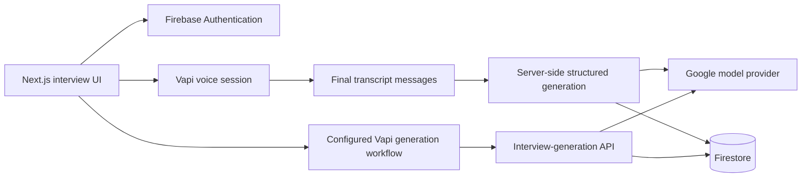

# AI Mock Interviews

**Practice answering interview questions aloud and review structured feedback.**

A Next.js application combining voice conversations, generated interview questions, account management, and saved feedback. The repository connects the user-facing interview flow to Vapi, Firebase, and a Google model through the AI SDK.

## The problem it addresses

Interview preparation needs both repetition and feedback. This project brings question generation, spoken practice, and a review page into one workflow so a candidate can revisit interviews and compare the feedback they receive.

## Main capabilities

- Email/password sign-in screens and Firebase-backed user sessions.
- Interview generation based on role, level, technology stack, type, and question count.
- Voice interview sessions through the Vapi web client.
- Transcript-based feedback generated against a structured schema.
- Saved interviews and feedback in Firestore.

## Local setup

Use Node.js and npm. Download the source and install the dependencies at the repository root:

```bash
npm install
npm run dev
```

Open the local URL printed by Next.js. Configure the required service accounts in `.env.local` before using authentication or interview features.

| Integration | Configuration used in this repository |
|---|---|
| Firebase browser client | `NEXT_PUBLIC_FIREBASE_API_KEY`, `NEXT_PUBLIC_FIREBASE_AUTH_DOMAIN`, `NEXT_PUBLIC_FIREBASE_PROJECT_ID`, `NEXT_PUBLIC_FIREBASE_STORAGE_BUCKET`, `NEXT_PUBLIC_FIREBASE_MESSAGING_SENDER_ID`, `NEXT_PUBLIC_FIREBASE_APP_ID`, `NEXT_PUBLIC_FIREBASE_MEASUREMENT_ID` |
| Firebase Admin | `FIREBASE_PROJECT_ID`, `FIREBASE_CLIENT_EMAIL`, `FIREBASE_PRIVATE_KEY` |
| Vapi | `NEXT_PUBLIC_VAPI_WEB_TOKEN`, `NEXT_PUBLIC_VAPI_WORKFLOW_ID` |
| Question and feedback model | `GOOGLE_GENERATIVE_AI_API_KEY`, used by the [Google provider](https://v4.ai-sdk.dev/providers/ai-sdk-providers/google-generative-ai#provider-instance) |

Firebase requires Authentication and Firestore configuration. The Vapi workflow must match the variables passed by `components/Agent.tsx` and call a reachable `POST /api/vapi/generate` endpoint with `role`, `level`, `techstack`, `type`, `amount`, and `userid`. A workflow is not provisioned by starting Next.js; a hosted Vapi workflow cannot reach a localhost-only API without a configured reachable development or deployment URL.

Keep Firebase Admin credentials on the server. Only provider-designated browser configuration should use the `NEXT_PUBLIC_` prefix.

## Example workflow

1. Create an account and open the interview-generation screen.
2. Complete the configured voice workflow to generate an interview.
3. Open the interview and answer the questions aloud.
4. End the call and review the generated feedback page.

## Architecture



| Source | Responsibility |
|---|---|
| [`components/Agent.tsx`](components/Agent.tsx) | Call lifecycle, transcript collection, and feedback trigger |
| [`lib/actions/general.action.ts`](lib/actions/general.action.ts) | Feedback generation and interview queries |
| [`app/api/vapi/generate/route.ts`](app/api/vapi/generate/route.ts) | Question generation and interview persistence |
| [`firebase/`](firebase) | Browser and server Firebase clients |
| [`constants/index.ts`](constants/index.ts) | Voice interviewer configuration and feedback schema |

## Current scope

External providers require compatible accounts, models, and configuration. Generated feedback is a practice aid and should be reviewed critically. Build with `npm run build` and serve the resulting Next.js application with `npm start` after configuring the required services.
